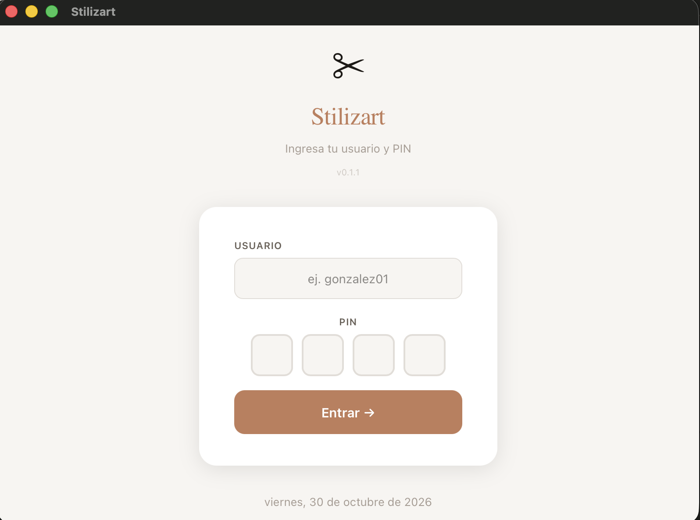
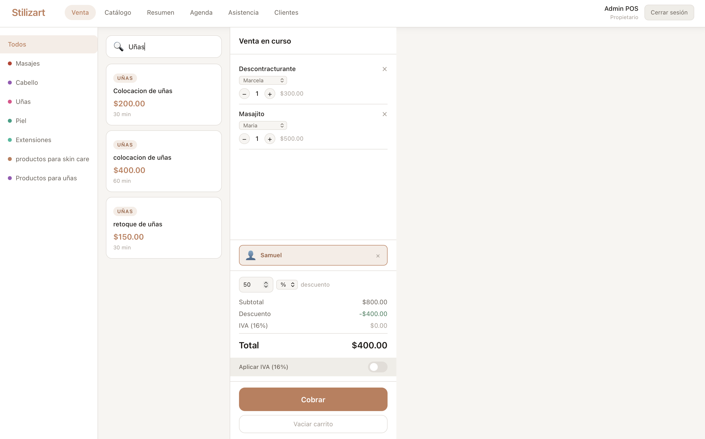
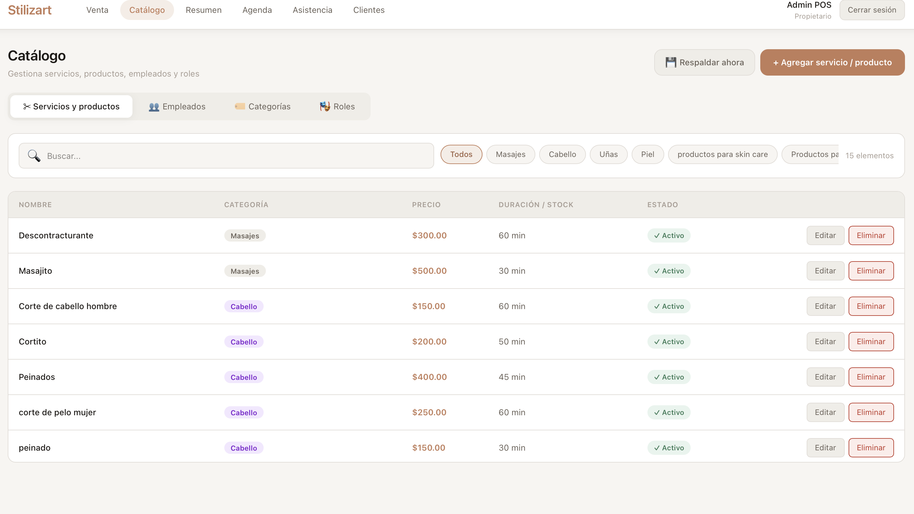
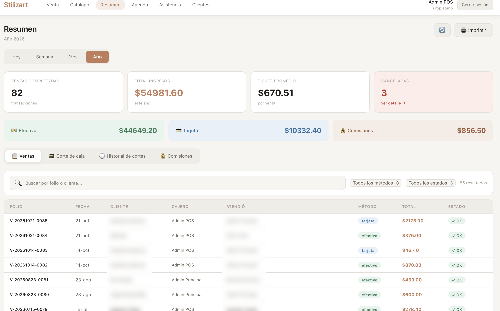
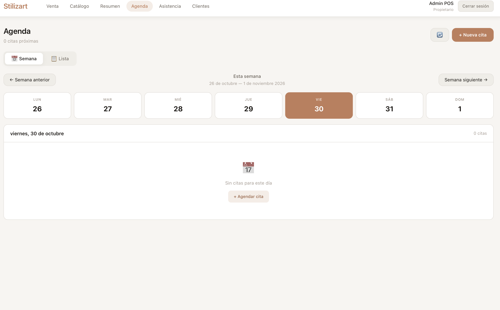

# Belleza POS — Sistema de Punto de Venta para Salón de Belleza

> 🔒 Este repositorio es una **vitrina de portafolio**. El código fuente completo vive en un repositorio privado por tratarse de software en producción para un cliente real. Aquí encontrarás arquitectura, decisiones técnicas y fragmentos seleccionados del código.

## 📋 Resumen

Aplicación de escritorio full-stack para la gestión integral de un salón de belleza (**Stilizart**), actualmente en producción. Cubre ventas, agenda de citas, control de empleados, asistencia y cierre de caja.

**Estado:** En producción, con actualizaciones automáticas desplegadas vía GitHub Actions.

## 🛠️ Stack técnico

| Capa | Tecnología |
|---|---|
| Frontend | React 18 + TypeScript + Vite |
| Backend/Runtime | Tauri v2 (Rust) |
| Base de datos | SQLite (rusqlite) |
| Build/Release | GitHub Actions → Windows installer (.msi/.exe) firmado |
| Distribución | Tauri Updater (auto-actualización silenciosa) |

**¿Por qué Tauri en lugar de Electron?** Decisión justificada por el tamaño del binario final, el consumo de memoria en equipos de gama baja (el entorno real de uso) y la posibilidad de aprovechar Rust para la lógica de negocio crítica (cálculos de caja, concurrencia de la BD).

## ✨ Módulos implementados

- **Control de acceso por roles** — sistema dinámico de roles y permisos (`roles` / `rol_permisos`), no hardcodeado
- **Agenda de citas** — con soporte para múltiples servicios por cita, variantes de servicio/precio, y resolución de bugs de zona horaria (UTC vs. hora local)
- **Ventas** — ticket con servicios/productos variables (precio según características), snapshot histórico de precios vendidos
- **Asistencia** — horarios individuales por empleado (fijos o variables por día), seguimiento de puntualidad
- **Cierre de caja** — tabla de snapshots (`cortes_caja`) para auditoría histórica
- **Clientes** — gestión y vinculación con citas/ventas

## 🏗️ Decisiones de arquitectura destacadas

### 1. Snapshot pattern para precios históricos
Los precios de servicios/productos cambian con el tiempo, pero una venta ya cerrada no debe verse afectada por cambios futuros. Se usa un patrón de snapshot: al vender o agendar, se copian nombre y precio actuales a la tabla transaccional (`venta_items`, `cita_servicios`), en lugar de solo referenciar el catálogo por FK.

### 2. Variantes de servicio sin duplicar catálogo
Un mismo servicio puede tener variantes con precio distinto (ej. "corte" con variantes por largo de cabello). Se resolvió con una tabla `servicio_variantes` y un id compuesto en el frontend (`servicio.id * 1000 + variante.id`) para distinguir selección sin complicar el modelo de datos.

### 3. Pipeline de release automatizado
Se migró de un flujo manual de build+firma+publish a GitHub Actions:
```
git tag vX.Y.Z && git push origin vX.Y.Z
  → corre en windows-latest
  → compila con Tauri Action
  → firma con llave minisign
  → publica en repo de releases separado
  → clientes reciben el update automáticamente
```

## 🧩 Fragmento de código (ejemplo real, simplificado)

```rust
// Patrón recurrente: Tauri exige camelCase explícito en payloads,
// o la serialización falla en silencio hacia el frontend.
#[derive(serde::Serialize)]
#[serde(rename_all = "camelCase")]
struct HorarioEmpleado {
    empleado_id: i64,
    tipo_horario: String, // "fijo" | "cambiante"
}
```

## 📸 Capturas

**Login con PIN**


**Pantalla de venta** — búsqueda de servicios, carrito con empleado asignado por línea, descuentos y cálculo de IVA


**Catálogo** — gestión de servicios, empleados, categorías y roles


**Resumen** — métricas de ventas, desglose por método de pago, historial de transacciones *(nombres de clientes difuminados por confidencialidad)*


**Agenda** — vista semanal de citas



---

**Nota:** Datos de clientes, nombres reales de empleados, y lógica específica del negocio del cliente han sido omitidos u omitidos de este repositorio por confidencialidad.
